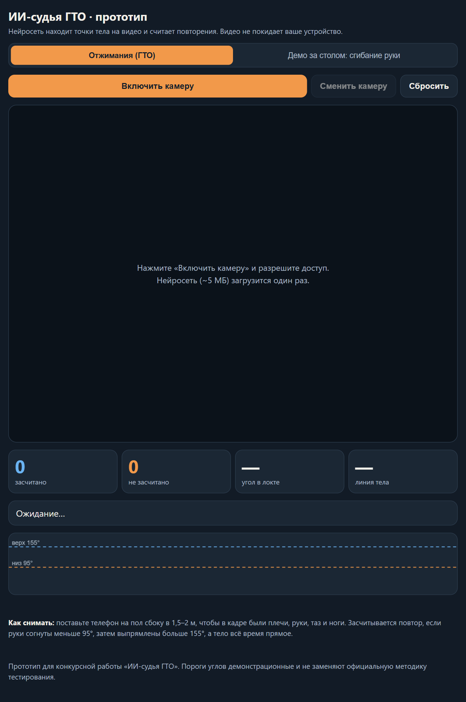
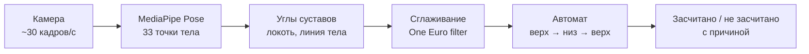

# ИИ-судья ГТО

**Смартфон считает повторения и проверяет технику — сдавать нормативы честно и без очередей.**

Прототип для конкурсной работы по искусственному интеллекту (МФЮА, 2026). Нейросеть MediaPipe Pose находит 33 точки тела на видео с камеры, по ним считаются углы в суставах, а автомат по правилам решает, засчитан ли повтор, и объясняет почему, если нет.

**[Открыть прототип →](https://chop-prog.github.io/gto-judge-ai/)** (нужна камера; видео не покидает устройство)



_English: a browser prototype of an AI judge for the Russian ГТО fitness test. MediaPipe Pose finds body landmarks on the camera feed, joint angles are computed from them, and a small state machine counts push-ups and rejects bad reps with a reason. Everything runs on the device._

## Зачем

ГТО сдают люди от 6 до 70+ лет, и нормативы принимают вручную: судья одновременно считает повторы и следит за техникой, результат зависит от его внимательности, а сдать можно только там, где есть обученные судьи и оборудование. ИИ-судья делает приём нормативов одинаково строгим для всех и возможным там, где нет центра тестирования, — в школе, в посёлке, дома для тренировки.

## Как это работает



1. **Поза.** MediaPipe Pose Landmarker (lite, ~5 МБ) работает прямо в браузере, на GPU или CPU.
2. **Сторона тела.** Судья берёт ту сторону, которую камера видит лучше, и не перескакивает на другую из-за мелких колебаний видимости.
3. **Углы.** Угол в локте — по точкам плечо–локоть–кисть, линия тела — плечо–таз–лодыжка (через скалярное произведение векторов).
4. **Сглаживание.** One Euro filter убирает дрожание точек, когда человек неподвижен, и почти не запаздывает при быстром движении.
5. **Правила отжимания.** Исходное положение — руки выпрямлены (угол больше 155°). Повтор засчитан, если руки согнуты меньше 95° и снова выпрямлены, а тело всё время прямое (линия тела не меньше 155°). Иначе судья называет ошибку: «руки согнуты мало» или «тело не прямое».

Пороги демонстрационные; в продукте они задаются по официальной методике ГТО и меняются без обновления модели. Есть и режим «Демо за столом» — сгибание руки, чтобы попробовать без отжиманий.

## Код

| Файл | Что внутри |
|---|---|
| [`src/judge.js`](src/judge.js) | Вся логика судьи без DOM: углы, выбор стороны, фильтр, автомат повторов, пороги |
| [`src/app.js`](src/app.js) | Камера, загрузка модели, отрисовка скелета, график угла, звук |
| [`tests/judge.test.js`](tests/judge.test.js) | 10 тестов логики на синтетических записях движения |

Тесты проверяют подсчёт правильных повторов, отбраковку неглубоких и с прогибом, игнорирование линии тела в демо-режиме, быстрые повторы и устойчивость к шуму распознавания (±4° на каждом кадре — счёт остаётся точным).

```bash
npm test          # node --test, без зависимостей
```

Локальный запуск: любой статический сервер в корне проекта (камера в браузере работает на `localhost` или по https).

## Что дальше (из конкурсной работы)

- **Защита от обмана:** вход по УИН участника и сверка лица, случайное задание перед стартом («поднимите левую руку»), запись без пауз с меткой времени и подписью.
- **Человек в контуре:** судья выборочно пересматривает записи и все спорные случаи.
- **Нормативы:** подтягивания, пресс, наклон; отдельные правила для участников с ОВЗ.
- **Данные:** по 152-ФЗ, видео хранится в России и удаляется после проверки.

## Как сделано

Прототип написан вместе с AI-ассистентом Claude Code: я ставил задачу и правила судейства, проверял работу на камере и тестах, правил пороги и поведение.

MIT License.
